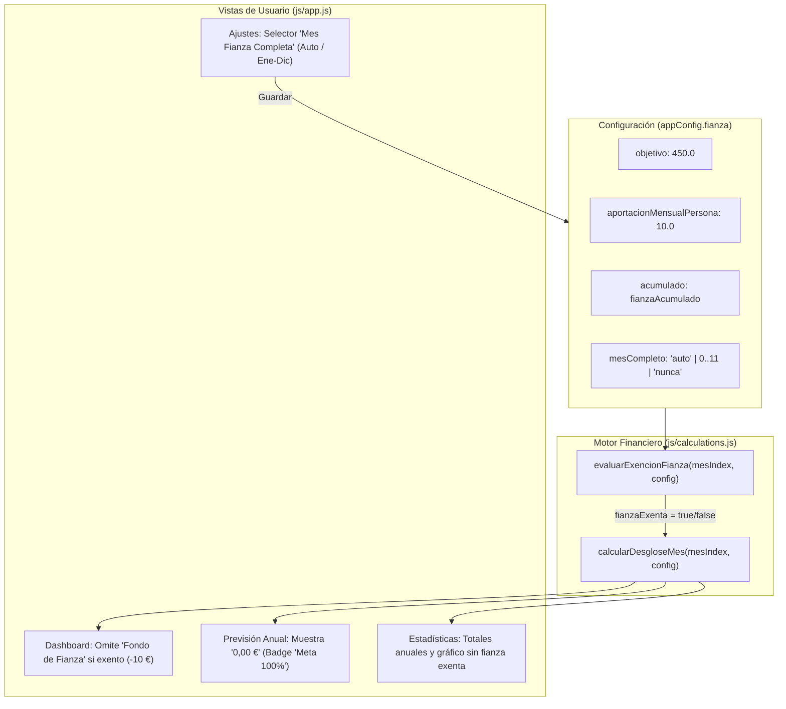

# Plan Técnico: 003 - Exención de Aportación al Fondo de Fianza al 100% (450 €)

**Estado:** Implementado ✅  
**Fecha:** 2026-10-19  
**Arquitecto:** Antigravity (GitHub Spec Kit)

---

## 1. Arquitectura de la Solución



---

## 2. Modificaciones Detalladas por Archivo

### A. `js/calculations.js`
1. **Lógica de Evaluación de Exención:**
   - Crear función auxiliar interna (y expuesta en `CalculationsModule` para pruebas):
     ```javascript
     function calcularMesFianzaCompleta(acumulado, objetivo, aportacionPersona) { ... }
     ```
   - Determinar si para un `mesIndex` dado la fianza debe ser 0,00 €:
     - Si `config.fianza.mesCompleto !== undefined && config.fianza.mesCompleto !== 'auto'`:
       - Si `config.fianza.mesCompleto === 'nunca'` o `config.fianza.mesCompleto === -1`: no exime.
       - Si es un número `0..11`: si `mesIndex >= config.fianza.mesCompleto`, la fianza está exenta.
     - Si está en `'auto'` o no definido:
       - Evalúa a partir de `config.fianza.acumulado` (o `410.0` por defecto) y `config.fianza.objetivo` (o `450.0`).
       - Si `acumulado >= objetivo`: exento para todos los meses.
       - Si no: proyecta mes a mes (mes 0, mes 1...). Cada mes añade `aportacionPersona * 2`. El mes en el que el acumulado alcanza el objetivo es el último mes de aporte (o si ya llega a 450, en los meses posteriores `fianzaExenta = true`).
   - Si `fianzaExenta === true`:
     - `fianzaIndividualCents = 0`.
     - NO añadir el concepto `{ nombre: 'Fondo de Fianza', valor: ..., tipo: 'fianza' }` a `conceptosOlga` ni a `conceptosPedro`.
   - Si `fianzaExenta === false`:
     - Se mantiene como hasta ahora (`10,00 €` para Olga y `10,00 €` para Pedro).

### B. `js/app.js`
1. **Sincronización de Configuración:**
   - En `cargarDatosLocalesInmediatos()` y donde se maneje `appConfig`, asegurar que `appConfig.fianza.acumulado = fianzaAcumulado`.
   - Soporte para `appConfig.fianza.mesCompleto` (por defecto `'auto'`).
2. **Dashboard (`actualizarDashboardMes`):**
   - Garantizar que `appConfig.fianza.acumulado = fianzaAcumulado` antes de invocar `calcularDesgloseMes(currentMonthIndex, appConfig)`.
   - Al llamar `calcularDesgloseMes`, si la fianza está exenta, no se mostrará el concepto en la lista y los totales reflejarán el importe neto sin los 10 €.
3. **Previsión Anual (`actualizarVistaPrevision`):**
   - Al iterar los meses `m = 0..11`:
     - Si `fianza === 0`: renderizar en la celda de fianza:
       ```html
       <span style="color:var(--text-muted);">0,00 €</span> <span class="prevision-badge fianza-completada">100%</span>
       ```
     - En las tarjetas móviles: reflejar `0,00 € (100%)`.
4. **Vista de Ajustes (`cargarInputsConfiguracion` y `guardarAjustes`):**
   - Capturar el nuevo selector DOM `#cfg-fianza-mes-completo`.
   - Cargar el valor (`'auto'`, `0..11`, o `'nunca'`).
   - Al guardar, validar y almacenar en `appConfig.fianza.mesCompleto`.

### C. `index.html`
1. **Formulario de Configuración (`#config-view`):**
   - En el bloque "Ahorro de Fianza", añadir el selector:
     ```html
     <div class="form-row">
       <label class="form-label" for="cfg-fianza-mes-completo">Mes Fianza Completa (100%)</label>
       <div class="input-wrapper">
         <select id="cfg-fianza-mes-completo" class="input-control">
           <option value="auto">Automático (según saldo)</option>
           <option value="0">Enero</option>
           ...
           <option value="11">Diciembre</option>
           <option value="nunca">No eximir este año</option>
         </select>
       </div>
     </div>
     ```

### D. `css/style.css`
- Estilo para el badge `.prevision-badge.fianza-completada` (color verde sutil, acorde al diseño Glassmorphism).

### E. `js/calculations.test.js`
- Tests unitarios exhaustivos para:
  1. `calcularMesFianzaCompleta()` en diversos saldos (450 €, 410 €, 0 €).
  2. `calcularDesgloseMes()` con fianza al 100% (exclusión del concepto y reducción de 10 € en totales).
  3. Comportamiento en modo manual (`mesCompleto = 2`) vs modo automático.

---

## 3. Plan de Verificación y Puertas de Calidad
1. `npm run test`: 100% de tests unitarios pasando.
2. `npm run lint`: 0 errores de ESLint.
3. `npm run build`: Compilación limpia con Vite.
